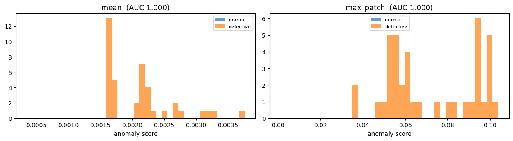
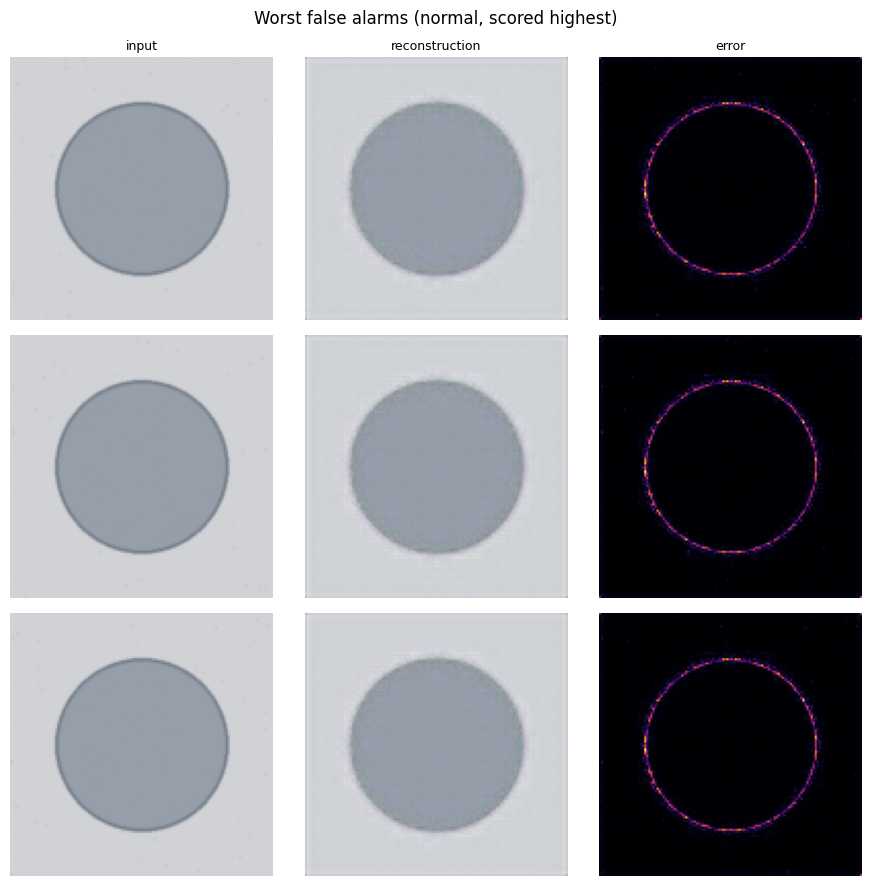

# Project 9 — Easy Explanation (with your results)

---

## 1. The idea (read this first)

Think of a **factory checker** who has only ever seen **good bottles**.

- You show the checker a bottle and ask: "Draw it again from memory."
- If the bottle is **good**, the drawing looks the same as the real one.
- If the bottle is **broken**, the checker draws a **good** bottle, because that's all they know.
- Now compare the photo and the drawing. **The place where they don't match = the broken part.**

Our computer model does exactly this. It is called an **autoencoder**.

- Small difference → **NORMAL** (good)
- Big difference → **ANOMALY** (broken)
- The line between "small" and "big" is called the **threshold**.

**Why do it this way?** In a factory we have thousands of photos of good products but very few photos of broken ones. So we teach the model using **good photos only**.

---

## 2. Easy word list (definitions)

| Word | Simple meaning |
|---|---|
| **Model** | The computer "brain" that learns from pictures. |
| **Deep learning** | Teaching a computer with many layers of maths, using lots of examples. |
| **Autoencoder** | A model that **squeezes** a picture small, then **redraws** it. |
| **Encoder** | The part that squeezes the picture (makes it smaller). |
| **Decoder** | The part that redraws the picture (makes it big again). |
| **Bottleneck** | The smallest, squeezed middle part. It forces the model to remember only the important things. |
| **Reconstruction** | The redrawn picture. |
| **Anomaly** | Something unusual or broken. |
| **Normal** | Good, nothing wrong. |
| **Pixel** | One tiny dot of a picture. |
| **Tensor** | A grid of numbers. A picture becomes a tensor so the computer can do maths on it. |
| **Channel** | A colour layer. A colour picture has 3: Red, Green, Blue. |
| **Training** | The model looking at examples again and again and getting better. |
| **Epoch** | One full round through **all** the training pictures. We do 40 rounds. |
| **Batch** | A small group of pictures processed together (we use 32). |
| **Loss** | A number for **how wrong** the model is. Lower = better. |
| **MSE** (Mean Squared Error) | Our loss: the average of (real pixel − drawn pixel)². |
| **Optimiser (Adam)** | The tool that changes the model a little after each batch, to make the loss smaller. |
| **Learning rate** | How big each change is. We use 0.001 (small, careful steps). |
| **GPU** | A special chip that makes training much faster. Colab gives one for free. |
| **Training set** | Pictures the model learns from (good only). |
| **Validation set** | Good pictures kept aside, **not** used for learning. We use them to pick the threshold. |
| **Test set** | Good **and** broken pictures, used only at the end to check how well it works. |
| **Overfitting** | The model memorises training pictures but fails on new ones. |
| **Anomaly score** | One number per picture: how badly the model redrew it. |
| **Threshold** | The cut-off score. Above it = ANOMALY. |
| **Percentile** | The 95th percentile = the value that 95% of the numbers are below. |
| **Heatmap** | A coloured picture showing **where** the error is. Bright = big error. |
| **Flask** | A small Python tool to make a website. |
| **Frontend** | What you see in the browser (the web page). |
| **Backend** | The Python code running behind it (the model and the logic). |

---

## 3. The notebook — step by step, with your results

The notebook runs on **Google Colab** (free online Python with a GPU).

### Step 1 — Setup

**What it does:**
- Loads the tools we need: PyTorch (deep learning), NumPy (maths), Matplotlib (graphs), PIL (images).
- Picks the GPU if there is one.
- Sets `SEED = 42` so the "random" parts give the **same result every time**.
- Connects Google Drive so files are saved.

**Your result:**
```
Device: cuda
Mounted at /content/drive
```
**Meaning:** `cuda` means a GPU was used, so it was fast. Google Drive is connected.

---

### Step 2 — Get the pictures (the dataset)

**What it does:**
- Looks for the real bottle photos (the **MVTec AD** dataset) in Google Drive.
- **If it can't find them, it makes fake pictures**: grey circles. Some have a scratch, a chip or a stain.
- Makes 3 lists:
  - training pictures (good only)
  - test good pictures
  - test broken pictures

**Your result:**
```
MVTec AD not found — generating a synthetic stand-in dataset.
train (normal only) 220
test normal         40
test defective      40
```
**Meaning:**
- ⚠ The real photos were **not found**, so your model learned from **fake circle pictures**.
- 220 good pictures for learning, 40 good + 40 broken for testing.
- **To fix it:** put the real MVTec "bottle" folder in `MyDrive/dl-project-09/data/bottle/` and run again.

---

### Step 3 — Settings and preparing pictures

**What it does:**
- Saves all the settings in `CONFIG`:
  - picture size 128×128
  - model size
  - scoring rule
- Every picture is:
  1. **resized** to 128×128
  2. turned into numbers between **0 and 1**
- Splits the 220 good pictures:
  - **85% for learning (187)**
  - **15% kept aside for validation (33)**
- **DataLoader** = a helper that hands pictures to the model in groups of 32.

**Your result:**
```
fit 187   validation-normal 33
```
**Meaning:** 187 pictures to learn from, and 33 good pictures kept aside to set the threshold later.

**Why 0 to 1?** The model's last layer (**Sigmoid**) always gives numbers between 0 and 1, so the input must be in the same range.

---

### Step 4 — Build the model

**What it does:** builds the autoencoder.

How one picture changes inside the model:

```
Picture 128×128 (3 colours)
   ↓ squeeze   64×64
   ↓ squeeze   32×32
   ↓ squeeze   16×16
   ↓ squeeze    8×8   ← BOTTLENECK (the smallest point, about 6× smaller)
   ↑ redraw    16×16
   ↑ redraw    32×32
   ↑ redraw    64×64
   ↑ redraw   128×128 (3 colours) = the redrawn picture
```

Each "squeeze" step has 3 parts:
- **Conv2d** — looks at small 4×4 areas to find patterns, and halves the size.
- **BatchNorm** — keeps the numbers steady, so learning is smooth.
- **ReLU** — changes negative numbers to 0, so the model can learn complex shapes.

Each "redraw" step uses **ConvTranspose2d**, which doubles the size.

The tools it uses:
- **Adam** (optimiser) with **learning rate 0.001**.
- **MSE** as the loss.

**Your result:**
```
856,771 parameters
```
**Meaning:** the model has about 857 thousand small numbers (**parameters** or **weights**) that it adjusts while learning.

**Why the bottleneck is important:**
- **Too big** → the model just copies everything, even the broken part, so it finds nothing.
- **Too small** → it can't even draw good bottles well, so everything looks broken.

---

### Step 5 — Training (the model learns)

**What it does, 40 times (40 epochs):**
1. Give the model a group of good pictures.
2. The model redraws them.
3. Compare each drawing with the **original** (the loss).
4. Adjust the model a little to do better (`backward` + `step`).
5. Check on the 33 validation pictures.
6. If this is the **best so far**, save it (`best_model.pth`).

**Your result (short):**
```
epoch   1  train 0.07986  val 0.06722  <- saved
epoch  10  train 0.00112  val 0.00157  <- saved
epoch  20  train 0.00066  val 0.00068  <- saved
epoch  40  train 0.00033  val 0.00035  <- saved
```

**Your graph:**


**How to read this graph:**
- **Across the bottom** = the epoch (training round 1 to 40).
- **Up the side** = the loss (how wrong the drawing is). Lower = better.
- **Blue line** = the training pictures. **Orange line** = the validation pictures.

**What it tells us:**
1. The loss **falls fast** in the first 10 rounds, then becomes almost flat near 0. The model learned to draw good pictures well.
2. **Blue and orange stay together**, so there is **no overfitting**: the model works on new good pictures too, not only the ones it learned from.
3. There's a **small bump in orange around epoch 5–7**. That's normal early in training; it settled down quickly.
4. "Saved" at epoch 40 means it was **still slowly improving**. More epochs could help a little.

---

### Step 6 — Give each picture a score

**What it does:**
1. Loads the best saved model.
2. For each test picture, it makes an **error map**: (real − drawn)² for every pixel.
3. It turns the error map into **one score**, in two different ways:

| Rule | How | Good | Bad |
|---|---|---|---|
| **mean** | the average error of the whole picture | steady | a tiny scratch gets "lost" in the big, clean background |
| **max_patch** | splits the picture into 16×16 squares and takes the **worst square** | finds small defects | more false alarms |

4. It checks each rule with **ROC-AUC**.

**What is ROC-AUC?** A score from 0.5 to 1.0 for **how well the scores separate good from broken**:
- **1.0** = perfect (every broken picture scores higher than every good one).
- **0.5** = no better than guessing.
- It doesn't need a threshold, so it's fair for comparing the two rules.

**Your result:**
```
mean       ROC-AUC 1.0000
max_patch  ROC-AUC 1.0000
Deploying: mean
```
**Meaning:** both rules were **perfect**, so it chose `mean` (the first one). They're perfect only because the fake pictures are very easy.

---

### Step 7 — Score graph (histogram)



**How to read it:**
- **Across the bottom** = the anomaly score. **Up the side** = how many pictures had that score.
- **Orange** = broken pictures. **Blue** = good pictures.
- The **left graph** uses the `mean` rule. The **right graph** uses the `max_patch` rule.

**What it tells us:**
- All the **broken** pictures score high: about 0.0016 to 0.0037 with `mean`.
- The **good** pictures score very low (around 0.0003). Their blue bars are squeezed into the far left and are so thin you can't see them.
- **There is a big gap between good and broken: no overlap at all.** That's why AUC = 1.0.
- With real bottle photos you'd expect the blue and orange to **overlap a bit**. That overlap is how hard the real problem is.

---

### Step 8 — Pick the threshold

**What it does:**
1. Scores the **33 good validation pictures**.
2. Takes the **95th percentile**: the score that 95% of good pictures are below.
3. That becomes the **threshold**.

**Your result:**
```
Threshold: 0.0003534382325597107
95th percentile ... implying roughly a 5% false-alarm rate on good product.
```
**Meaning:**
- Any picture scoring **above 0.00035** is called **ANOMALY**.
- Because we used the 95th percentile, about **5 in 100 good bottles** will be wrongly flagged. We accept that.

**If the teacher asks "why 95?":**
- A **higher** percentile (e.g. 99) → fewer false alarms, but more broken bottles slip through.
- A **lower** percentile (e.g. 90) → catches more broken bottles, but more false alarms.
- If missing a defect is dangerous (medicine, car parts), choose **lower** and let a human recheck the flagged items.

**Why only good pictures?** In real life you often don't have broken examples. Also, using test pictures to choose settings would be cheating.

---

### Step 9 — Final results (confusion matrix)


**How to read it:**
- **Rows** = what the picture **really is**. **Columns** = what the model **said**.

| | Model said NORMAL | Model said ANOMALY |
|---|---|---|
| **Really normal (40)** | **39** ✅ correct | **1** ❌ false alarm |
| **Really broken (40)** | **0** ❌ missed | **40** ✅ caught |

**Definitions:**
- **False alarm** (false positive) = a good bottle wrongly called broken.
- **Missed defect** (false negative) = a broken bottle wrongly called good. **This is the dangerous one.**
- **Precision** = of everything the model called broken, how much really was broken.
- **Recall** = of all the broken bottles, how many the model caught.
- **F1** = one number that balances precision and recall.

**Your result:**
```
roc_auc     1.0000
precision   0.9756   (40 out of 41 flagged were really broken)
recall      1.0000   (caught all 40 broken)
f1          0.9877
false_alarms 1
missed_defects 0
```
**Meaning:** it caught **every** broken picture and made only **1 false alarm out of 40** good ones (2.5%). That's below the 5% we planned for, so the threshold worked as expected.

---

### Step 10 — Looking at the hardest cases (error analysis)

Each row shows 3 pictures:
- **input** = the real picture
- **reconstruction** = the model's drawing
- **error** = the heatmap (bright = big difference)

#### A. "Missed defects" = the broken pictures with the LOWEST scores


**What we see:**
- The input has a **brown stain** on the circle.
- The model's drawing has **no stain**. It "repaired" it, because it only knows good circles.
- The heatmap **lights up exactly on the stain**. ✅ The model found the right spot.
- These were the hardest broken pictures, but they **were still caught** (0 missed). They're the "stain" type: soft colour, no sharp lines, so they scored lowest.

#### B. "False alarms" = the good pictures with the HIGHEST scores



**What we see:**
- The input is a perfectly **good** circle.
- The drawing is a bit **blurry**, especially at the **edge**.
- The heatmap lights up as a **thin ring on the edge** of the circle.

**Meaning:** the model is not great at drawing **sharp edges**. That small edge error is what pushed one good picture over the threshold.

**This is a good point for your report:** "False alarms come from blurry edges, not real defects. A bigger model or longer training could reduce this."

---

### Step 11 — Export (save for the app)

**What it does:** saves **3 files**, zips them, and downloads the zip.

| File | What's inside |
|---|---|
| `best_model.pth` | the learned weights (the "brain") |
| `classes.json` | the two labels: `["normal", "anomaly"]` |
| `config.json` | all the settings + **the threshold** + the results |

**Next step:** unzip into the app's `model/` folder.

---

## 4. The app (the website)

### The big picture

```
YOU (browser)  →  upload a photo
      ↓
app.py (Flask)          receives the photo
      ↓
webio.py                checks the file is safe (type, size, not empty)
      ↓
preprocessing.py        resize to 128×128, numbers 0–1  (same as training)
      ↓
model.py                the same autoencoder → redraws the photo
      ↓
inference.py            error → score → compare with threshold → NORMAL / ANOMALY
      ↓
visualise.py            makes the drawing + heatmap pictures
      ↓
index.html              shows the answer + 3 pictures
```

### Each file in one or two lines

**Backend (Python):**

| File | What it does | Why |
|---|---|---|
| `app.py` | Starts the website. When you upload, it runs the model and shows the result. | It's the "front door" of the app. |
| `src/artifacts.py` | Reads `config.json`, `classes.json` and `best_model.pth`. Gives a clear message if one is missing. | All settings come from **one place**, so the app and the notebook never disagree. |
| `src/model.py` | The **same** autoencoder as the notebook. | The saved weights only fit the exact same model shape. |
| `src/preprocessing.py` | Opens the photo, fixes phone rotation, makes it RGB, resizes it, and turns it into numbers 0–1. | It must be the **same** as training, or the model gets confused. |
| `src/inference.py` | Loads the model **once**, redraws the photo, calculates the score, and compares it with the threshold. | This is the main "brain" step. |
| `src/visualise.py` | Turns numbers back into pictures and makes the coloured heatmap. | It shows **where** the problem is. |
| `src/webio.py` | Checks uploads (file chosen? right type? not empty? under 8 MB?). Puts pictures straight into the page. | **Safety**: never trust uploaded files. |

**Frontend (web page):**

| File | What it does |
|---|---|
| `templates/_base.html` | The shared page layout: title bar, error box, result box, footer. |
| `templates/index.html` | The upload form, the big NORMAL/ANOMALY word, the score, and the 3 pictures. |
| `static/css/style.css` | Colours and big text, so it's easy to read on a projector. |

**Helpers:**

| File | What it does |
|---|---|
| `tools/make_dummy_artifacts.py` | Makes a fake **untrained** model so the website can be built before training finishes. |
| `tools/check_setup.py` | A health check: Python version? Packages installed? Model files present? Does one prediction work? |
| `tests/test_inference.py` | 4 automatic checks: the threshold exists, the drawing is the same size as the input, the score is 0 or more, and max_patch ≥ mean. **All pass.** |
| `requirements.txt` | The list of Python packages to install. |
| `.gitignore` | Files **not** to put on GitHub (the big `.venv`, the dataset photos). |

### What you see on the web page

1. Choose a photo → press **Inspect**.
2. A big word: **NORMAL** (green) or **ANOMALY** (red).
3. A line like: "Score 0.00098 against threshold 0.00035 (**2.76×** the threshold)".
   - **×** = how many times bigger than the threshold. Above 1 = anomaly.
4. Three pictures: **input**, **reconstruction**, **heatmap**.
5. The footer shows the model name and training date, and **"⚠ Untrained placeholder weights"** if the real model isn't installed yet. **Right now it IS showing this.**

---

## 5. What is each thing in the VS Code sidebar

| Item | What it is | Do you touch it? |
|---|---|---|
| `.claude` | Settings so Claude can start the app. | No |
| `.pytest_cache` | Notes left behind by the test tool (pytest) to run faster next time. Safe to delete. | No |
| `.venv` | **Virtual environment**: a private box with Python + all the packages (torch, flask...) just for this project. It's huge, so it's not put on GitHub. | No |
| `.vscode` | VS Code settings: which Python to use, and the **Run buttons** (F5). | No |
| `model` | The trained "brain": `best_model.pth`, `config.json`, `classes.json`. | Replace with your Colab zip |
| `notebook` | `training.ipynb`, the Colab notebook that trains the model. | Run in Colab |
| `src` | The backend Python code: model, preprocessing, inference, pictures, uploads. | Read / explain |
| `static` | `css/style.css`, the look of the web page. | Optional |
| `templates` | The HTML web pages (`_base.html`, `index.html`). | Edit the "What this is" text |
| `tests` | Automatic checks + 2 sample pictures in `fixtures`. | Run them |
| `tools` | `check_setup.py` (health check) and `make_dummy_artifacts.py` (fake model). | Run check_setup |
| `.gitignore` | A list of things Git must **not** upload. | No |
| `app.py` | **Starts the website.** The main file you run. | Run it |
| `README.md` | Instructions from your teacher. | Read |
| `requirements.txt` | The list of packages to install. | Used once by pip |

Files and folders starting with a dot (`.`) are **hidden helper files**. You normally don't edit them.

---

## 6. How to run it in VS Code (step by step)

**Option A: the Run button (easiest)**
1. In VS Code, click the **Run and Debug** icon on the left (a ▶ with a bug).
2. At the top, choose **"Check setup"** → press the green ▶.
   You should see `[ OK ]` lines, and finally **"Ready."**
3. Now choose **"Run Flask app (port 5001)"** → press the green ▶ (or press **F5**).
4. The terminal at the bottom shows: `Running on http://127.0.0.1:5001`.
5. **Cmd-click** that link (or open it in Chrome).
6. Click **Choose File** → pick `tests/fixtures/example_defective.png` → click **Inspect**.
7. To stop it, press the red ■ square at the top.

**Option B: the Terminal**
Open the terminal in VS Code (**View → Terminal**) and type:
```bash
source .venv/bin/activate
python tools/check_setup.py
python app.py
```
Then open http://127.0.0.1:5000. Press **Ctrl + C** in the terminal to stop.

**Run the tests:** type `python -m pytest tests`. You should see `4 passed`.

**What each command means:**
- `source .venv/bin/activate` → "use this project's private Python box".
- `python tools/check_setup.py` → "check everything is installed and the model works".
- `python app.py` → "start the website".
- `python -m pytest tests` → "run the automatic checks".

**What I got when I ran it:**
- Tests: **4 passed** ✅
- Website: it opens and works ✅
- Uploading the defective test picture gave **ANOMALY**, score 0.065. That answer is meaningless for now, because the footer says **"⚠ Untrained placeholder weights"** (the real model isn't in `model/` yet).

---

## 7. `app.py` explained line by line (easy)

```python
from flask import Flask, render_template, request
```
Bring in Flask (to make the website), `render_template` (to fill in the HTML page) and `request` (what the user sent).

```python
ALLOWED = {".png", ".jpg", ".jpeg", ".bmp"}
```
Only these picture types are allowed.

```python
app = Flask(__name__)
app.config["MAX_CONTENT_LENGTH"] = 8 * 1024 * 1024
```
Create the website. Files bigger than 8 MB are refused.

```python
def page(**context): ...
```
A small helper that shows the page and always fills in the footer (model name, training date).

```python
@app.route("/", methods=["GET", "POST"])
def index():
```
When someone opens the home page (`/`), run this function.
- **GET** = just opening the page.
- **POST** = they pressed "Inspect".

```python
    if request.method != "POST":
        return page()
```
If they just opened the page, show the empty form.

```python
        raw = read_upload(request.files.get("image"), ALLOWED)
```
Get the uploaded file and check it's OK.

```python
        result = inference.predict(raw)
```
**Run the model**: get NORMAL or ANOMALY, and the score.

```python
        views = {"original": ..., "reconstruction": ..., "heatmap": ...}
```
Make the 3 pictures to show.

```python
        return page(result=result, views=views)
```
Show the page with the answer.

```python
    except UploadError as exc:
        return page(error=str(exc))
```
If the user picked a bad file, show a friendly message.

```python
    except Exception as exc:
        app.logger.exception("scoring failed")
        return page(error="Could not process that image (...)")
```
If something else broke, write the details in the terminal and show a short message.

```python
@app.errorhandler(413)
def too_large(_): ...
```
If the file is too big, show "too large (8 MB maximum)".

```python
if __name__ == "__main__":
    inference.warm_up()
    app.run(host="127.0.0.1", port=..., debug=False)
```
Only when you run `python app.py`:
1. Load the model once, so the first upload is fast.
2. Start the website on your own computer (`127.0.0.1`).

The port is **5000** by default, or **5001** when you use the VS Code Run button.

---

## 8. Short answers for the teacher

| Question | Answer |
|---|---|
| What does your project do? | It finds broken products in photos, using a model trained only on good products. |
| What is an autoencoder? | A model that squeezes a picture and redraws it. |
| Why train on good pictures only? | Broken examples are rare, and defects can be any shape. |
| How do you decide if it's broken? | If the redrawn picture is very different from the real one (score above the threshold). |
| What is the loss? | MSE: the average squared difference between the real and redrawn picture. |
| Why Sigmoid at the end? | It keeps the output between 0 and 1, the same as the input. |
| What does BatchNorm do? | It keeps the numbers steady, so training is smoother. |
| What does ReLU do? | It sets negative numbers to 0, so the model can learn complex shapes. |
| Why a validation set? | To pick the threshold from good pictures the model never learned from. |
| How did you pick the threshold? | The 95th percentile of the validation scores, which means about 5% false alarms. |
| mean vs max_patch? | mean = steady but can miss tiny defects. max_patch = catches tiny defects but gives more false alarms. |
| What is ROC-AUC? | How well the scores separate good from broken. 1 = perfect, 0.5 = guessing. |
| Precision vs recall? | Precision = how many flagged were really broken. Recall = how many broken we caught. |
| What did the heatmap show? | It lit up on the stain (correct), and on the circle edges for good pictures (blurry drawing). |
| Is there overfitting? | No. The training and validation losses stay together. |
| What if missing a defect is very bad? | Lower the threshold: catch more, accept more false alarms, and let a human recheck. |
| Who is responsible? | A human checks the flagged items. The threshold doesn't work for other products or other lighting. |

---

## ⚠ Be honest in the viva

Your results come from **fake circle pictures**, because the real bottle photos weren't in Google Drive.

That's why everything is almost perfect. Add the real MVTec "bottle" data, run the notebook again, and use those numbers. With real photos, expect lower (more realistic) scores.
