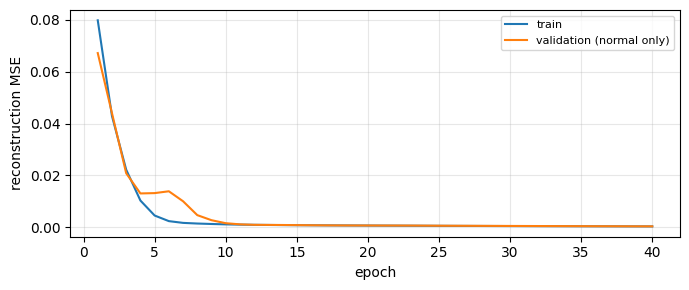
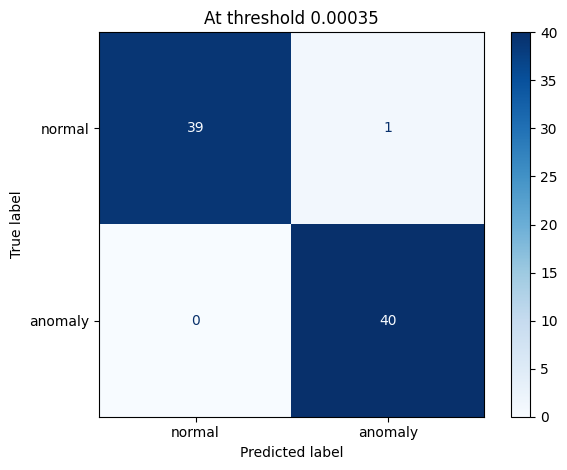
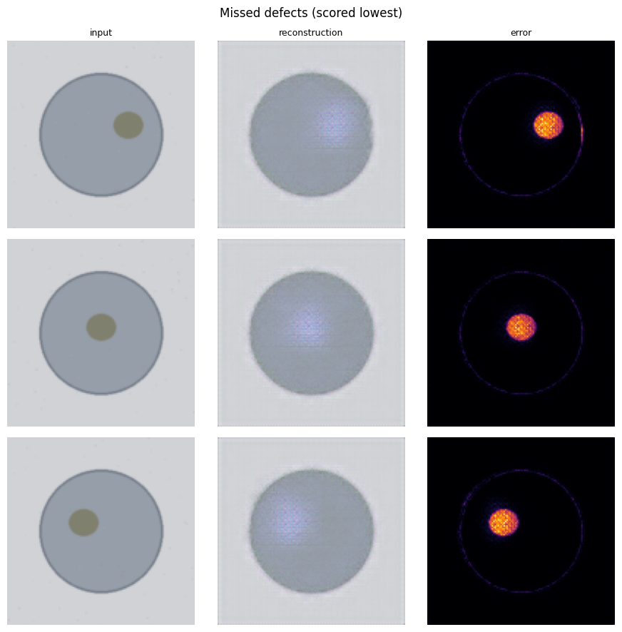

# Visual Defect Detection

Coursework that finds defective products in images using a convolutional autoencoder trained on normal images only, served as a small Flask web app with an error heatmap.

## How it works

1. The autoencoder learns to squeeze and redraw **normal** products only.
2. Given a defective product, it redraws it as if it were normal.
3. The difference between the input and the redrawn image is the **anomaly score**.
4. A score above the **threshold** means ANOMALY, and the heatmap shows where the difference is.

## What the notebook does

1. **Data**: loads one MVTec AD category (`bottle`), or generates a synthetic stand-in dataset if it isn't found
2. **Split**: keeps 15% of the normal training images aside as a validation set
3. **Model**: builds a 4-level convolutional autoencoder (128×128 input, 8×8 bottleneck, 856,771 parameters)
4. **Training**: trains for 40 epochs with Adam (lr 0.001) and MSE loss, saving the best validation checkpoint
5. **Scoring rules**: compares `mean` (average error) against `max_patch` (worst 16×16 patch) by ROC-AUC
6. **Threshold**: sets it at the 95th percentile of scores on the normal validation images
7. **Evaluation**: reports precision, recall, F1 and a confusion matrix at that threshold
8. **Error analysis**: plots input, reconstruction and error map for the hardest cases
9. **Export**: saves `best_model.pth`, `config.json` and `classes.json` for the app

## Results

> These results come from the notebook's **synthetic** dataset (grey discs with scratches, chips and stains), because MVTec AD was not available in Drive for this run. They show the pipeline works end to end. They are not a benchmark on real bottles.

| | |
|---|---|
| Training images (normal) | 187 fit, 33 validation |
| Test images | 40 normal, 40 defective |
| ROC-AUC (`mean`) | 1.000 |
| ROC-AUC (`max_patch`) | 1.000 |
| Deployed rule | `mean` |
| Threshold | 0.00035 (95th percentile of normal validation scores) |
| Precision | 0.976 |
| Recall | 1.000 |
| F1 | 0.988 |
| False alarms | 1 of 40 normal |
| Missed defects | 0 of 40 defective |

Training and validation loss fell together from about 0.08 to 0.0003, so the model wasn't overfitting:



At the chosen threshold, 39 of 40 normal images passed and all 40 defective images were caught:



**Error analysis**
- The lowest-scoring defects were soft stains. They were still caught, and the heatmap highlights the stain itself.
- The highest-scoring normal images light up only along the disc's outline, because the autoencoder redraws sharp edges slightly blurred.



## Data

Uses one category of [MVTec AD](https://www.mvtec.com/company/research/datasets/mvtec-ad). It isn't included in this repo: accept the licence, download the `bottle` category, and place it in Google Drive at `MyDrive/dl-project-09/data/bottle/`. Without it, the notebook generates the synthetic stand-in dataset described above.

## Running it

Train in Google Colab with `notebook/training.ipynb`, then unzip the export into `model/`. A trained model is already included.

```bash
python -m venv .venv
source .venv/bin/activate
pip install -r requirements.txt
python tools/check_setup.py
python app.py
```

Open http://127.0.0.1:5000 and upload a picture from `demo-pictures/`. Run the tests with:

```bash
python -m pytest tests
```

## Files

- `notebook/training.ipynb`: training, evaluation and export, with outputs
- `app.py`: the Flask web app
- `src/`: model, preprocessing, inference, heatmap and upload handling
- `templates/`, `static/`: the web page and its styling
- `model/`: the trained model, settings and threshold
- `tests/`: automatic checks and two sample images
- `tools/`: setup check and placeholder-model generator
- `demo-pictures/`: normal and defective images for a live demo
- `EXPLAINED.md`: a plain-English walkthrough of every part of the project

## Responsible use

This is an educational prototype. A flagged item should be checked by a person, and a threshold set on one product or lighting setup doesn't transfer to another.
